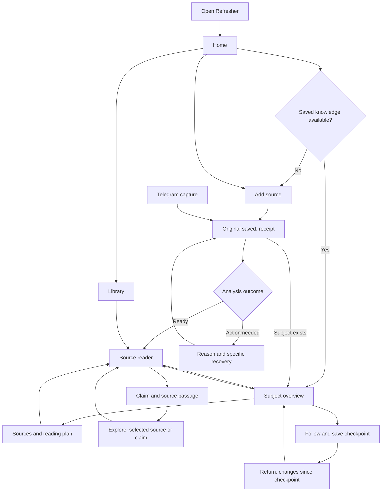

# Refresher: recommended user journey

29 October 2026 · `olga/ux` · UX proposal, not an implemented redesign

## Product decision

Make Refresher feel like a place to **return to a subject and understand what matters now**.
Saving content feeds that experience. Sources and evidence explain it. The graph helps people explore it.

The main loop is:

**Save something → find a subject → understand the brief → read a source → follow the subject → return to what changed.**

Assumed audience: a person accumulating articles, forwarded posts, notes and documents, who wants to recover useful knowledge without rereading everything. The jury should experience this same product loop through a prepared example.

This is a recommendation based on the current repository, not a claim of measured user preference. Validate the proposed hierarchy with the tasks at the end before a broad redesign.

## What was inspected

Source review covered the unified server and routes, capture workspace, shared navigation and styling, Home, Brief, subject reading navigator, Atlas and proposal handling, Telegram entry points, CLI/Compose entry points, ingestion states, and existing product/reading plans. Backend modules and tests were mapped to these experiences; this is not a line-by-line correctness or security audit.

The route contracts below were checked in source. No live browser session, live model processing, or usability study was run for this proposal. Older README/frontend notes describe earlier capabilities; the current implementation takes precedence.

| Surface | Current behavior and evidence | UX consequence |
| --- | --- | --- |
| Unified app | `refresher/app.py`: `/` serves Topics; `/brief/`, `/topic/`, `/capture/`, `/atlas/` are separate surfaces | A common shell exists; use it as the foundation |
| Home | `static/topics.html` and `topics.js`: search, topics, clusters and followed threads lead to `/brief/` | Good product entry, but the vocabulary exposes internal structure too early |
| Brief | `static/context.html` and `static/brief/`: ideas, sources, inline reading, versions and subject context | Already close to the main experience; keep this as the default subject entry |
| Source navigator | `static/dossier.html` and `dossier.js`: reading plan, cluster map, all-results view and reader | Useful deeper exploration, but overlaps with Brief reading |
| Global Read | `app.py` redirects `/read/` to `/atlas/?layout=read`; subject tabs link to `/read/` without subject state | A reader can lose the subject they were following |
| Navigation | `static/nav.js`: `/` and `/topic/` activate Topics, but `/brief/` does not; Consolidate is inserted into global navigation | The main destination loses its active indicator; maintenance competes with reading |
| Capture | `static/index.html`, `app.js`, `web.py`: form, submission list, result dialog, retry and evidence | Solid retention feedback, but adding content and browsing a library share one busy screen |
| Capture handoff | `app.js` links placed results to bare `/atlas/` | The user must find their new source again |
| Atlas | `assets/map/app.js` supports `item`, `claim`, `idea`, `cluster` URL parameters | Contextual evidence links can reuse existing capabilities |
| Review | Navigation uses `/atlas/#proposals`; the section is `#review` and its inner list is `#proposals` | The link reaches the list rather than the section explanation; align the target with the intended heading |
| Input capability | `web.py:file_text` reads supported UTF-8 text and native-text PDFs; scans and other formats are retained with a parsing message | Browser upload support must be described separately from Telegram image/PDF support |
| Telegram | `channels/telegram.py`: capture, processing messages, consolidation; some responses direct users to start the server | Convenient capture channel, but the return to the web experience needs a configured, reachable destination |
| Deployment | Compose `app` runs the unified application on the selected vault; standalone `refresher.web` is capture-only | Demo instructions must open the unified app and use the intended vault |

## Navigation: three everyday destinations

Desktop header:

```text
refresher.       Home     Library     Explore                 [+ Add source]
                         Updates & suggestions (3) · More
```

“Updates & suggestions” belongs in a quiet utility area, with a count of actionable decisions. “More” contains connection/setup help and processing controls. It can initially be a simple disclosure; no settings subsystem is necessary.

| Label | Purpose | Initial implementation |
| --- | --- | --- |
| Home | Resume, search, followed subjects, recent changes | Evolve `/`; keep the current search and subject cards |
| Library | Find saved originals and their processing state | Reuse capture's saved-source list; a separate route/filter model is proposed work |
| Explore | See relationships across knowledge | Reuse `/atlas/`; show a plain explanation of what the map means |
| Add source | Save text, a link or a file | Keep `/capture/`; visually prioritize this action |
| Updates & suggestions | Decide proposed organization changes | Initially link to the existing Atlas review section, clearly label this temporary placement |

Remove global “Read”: reading is an action on a source, and should preserve its subject. Put “Update connections” inside processing controls instead of presenting “Consolidate” beside everyday destinations.

Inside a subject, offer **Overview · Sources**. Overview maps to the current Brief; Sources maps to the existing reading navigator. Both carry the same `id` or `q`. Evidence is opened from a specific idea/source, not a third competing subject tab. Keep old routes working as aliases; navigation cleanup must not invalidate bookmarks.

## Entry points and destinations

| Arrival | Landing | Next action | Return behavior |
| --- | --- | --- | --- |
| First visit, empty vault | Home with one short promise and a first-source action | Add first source; optional prepared example | Return to Home when there is something useful to open |
| Returning visit | Home with Continue and followed subjects | Continue reading or open changes | Preserve the last subject and reading position |
| Shared/bookmarked subject URL | That subject's Overview | Read the brief, then a cited source | Home stays one click away; no forced onboarding |
| Shared source URL | Source reader with its subject if supplied | Read; inspect evidence or original | Explicit Back to subject; sensible Library fallback if no subject |
| Telegram capture | Receipt in Telegram, followed by a result link when available | Open this source in the same vault | Return to its subject or Library |
| Upload/link error | Original receipt, reason, actionable recovery | Paste text, split file, retry if appropriate | Keep the same receipt; do not make the user resubmit blindly |
| Jury demo | Home with explicitly labeled example data | Open an example subject and trace an idea to evidence | Offer Add source after the first value demonstration |

Do not add account creation or a marketing-site detour to the current local demo. Public hosting, authentication and public share links are separate future product work. A localhost URL in a Telegram message will not open the laptop's app from another device; only offer links when the configured deployment is reachable from that device.

## Journey 1: first useful experience

1. **Home:** “Your saved knowledge, ready when you need it.” Supporting line: “Save articles and notes. Return to a clear overview, with links to the original sources.”
2. Empty vault: primary **Add your first source**, secondary **See an example**. Do not show a search that can only return empty results as the primary task.
3. **Add source:** choose Text, Link or File. Show the relevant capability and limit before submission. Keep title optional. Button: **Save source**.
4. After durable storage, show **Original saved** immediately. Keep the receipt on screen while background work continues. Offer **Add another source** without interrupting processing.
5. Report actual stages: Reading content → Extracting ideas → Checking against source → Connecting. Do not invent percentages or promise a completion time.
6. When ready, show the source title, a short result summary and **Open source**. If a real subject association exists, offer **Explore [subject]**. If none exists yet, say so and keep reading available.
7. In the reader, let the user open an extracted idea and see its exact source passage. This is the first trust moment.
8. Offer **Follow this subject** only when a subject exists. No topic approval or graph-management step is required before reading a source.

The current sample action only prefills the capture form. Keep that behavior labeled **Fill with sample text**. A future **See an example** must open a clearly labeled, prepared dataset without submitting content or making unexpected model calls.

## Journey 2: return and refresh a subject

1. Home presents **Continue [source]** when a previous reading position exists, then followed subjects and recent subjects. Otherwise search is the main action.
2. Search label: **What would you like to revisit?** Existing topic suggestions help the user recognize a subject without remembering its exact name.
3. A subject opens in **Overview**, with its title, available source count, and a compact explanation of the main ideas. For a followed subject with a saved baseline, show **What changed since [date]**.
4. Distinguish changed ideas, newly added sources and unresolved disagreements. A new capture is not automatically a change in knowledge.
5. One primary action: **Start reading**, or **Continue reading** if progress exists. Keep **Follow subject** secondary and make its current state visible.
6. Opening a citation puts the source beside the brief on desktop. On mobile it opens one readable view with **Back to [subject]** above it.
7. **Mark read** is an explicit, reversible action. Scrolling, visiting a page or closing a source must not silently mark it read.
8. Keep **Save checkpoint** separate from Mark read. Explain: “Compare future updates with this version.” Existing saved versions/stamps are a foundation; unify their meaning and naming before presenting them as one action.

If no baseline exists, say **First overview — save a checkpoint to compare future changes**. If nothing changed, say **You're up to date with your saved sources**, with the comparison date. Avoid implying comprehensive knowledge of the outside world.

## Journey 3: read deeply without losing the path

From subject Overview, **Sources** opens the subject's reading navigator. It keeps the current subject, selected source and progress.

Desktop: reading plan on the left, source text in the center, optional context on the right. Start with related reading visible; people, organizations and extracted ideas expand on request. Maps are useful orientation tools, but a visible text list must also support navigation.

The reader should always answer:

- Where am I? **Home / [subject] / [source]**.
- Why this source? One concrete sentence about its contribution to this subject.
- What next? One **Next source** action; no competing “Start here” buttons.
- How do I leave? **Back to overview** or **Back to reading plan**, returning to the previous scroll position.

Opening a related source is a detour. Keep a visible **Back to [previous source]** link. Do not silently replace the reading plan or mark any source read. Browser Back must retrace the detour, not exit the application.

If coverage percentages remain, explain that they estimate coverage of extracted ideas in this collection. They do not measure the reader's understanding or completeness of the field. Replace the user-facing role “noise” with **Overlapping sources**, **Less relevant**, or **Not analyzed**, according to the actual reason; retain access to all originals.

## Journey 4: verify a claim

1. Click an idea or citation while reading.
2. Show its claim text, source passage, author when known, and source date when known. State missing attribution honestly.
3. Label automated review **Checked against this source**. Do not label it “Fact verified”.
4. Offer **Explore connections** to the Atlas with the source/claim already selected. Existing `item` and `claim` parameters support this direction.
5. Preserve a return link to the exact subject/source. Normal evidence inspection stays in the app; **Open original website ↗** opens an external tab.

Show disagreements as attributed positions, with evidence for each. “Updated by a newer source” must link to the newer source and explain the relation. A person's ranking is contextual to the selected subject; avoid a universal “trusted expert” badge.

## Journey 5: organize when the user chooses

Updates & suggestions is an optional maintenance task. It should not block capture or reading.

Each suggestion needs: **what changes → why → affected sources → Accept / Dismiss**. Use specific actions such as **Create topic** or **Merge these topics** when possible. Show a success receipt and keep a history. Undo requires a verified backend reversal contract; do not display an Undo control until it exists.

If a suggestion changed since it was opened, explain that its evidence changed and load the current version before accepting. Preserve the existing stale-decision protection. Do not conflate these manual decisions with automated extraction review or retryable processing failures.

## Screen hierarchy and visual direction

Keep the existing warm cream, cobalt actions, editorial headings, restrained yellow accents and system fonts. The strongest design improvement is a consistent hierarchy across pages.

| Screen | First thing to understand | Main action | Quiet supporting content |
| --- | --- | --- | --- |
| Empty Home | What Refresher does | Add first source | Example, accepted formats |
| Populated Home | Where to resume | Continue, otherwise choose a subject | Changes, recent subjects |
| Subject Overview | What matters in this collection | Start/Continue reading | Follow, checkpoint, source list |
| Source reader | What I am reading and why | Next source | Evidence, original, context |
| Add source | What I can submit | Save source | Format limits, retention note |
| Source receipt | Saved versus analyzed | Open source or relevant recovery | Actual stages and diagnostics disclosure |
| Library | Where my saved content is | Open a source | Search, filters, status |
| Explore | What relationships mean | Select a topic/source | Legend, list alternative, evidence |

Keep the brain artwork on first-use capture or an introduction, with its existing pause/reduced-motion behavior. Collapse the large hero for repeat capture so the input is immediately reachable. Avoid marketing copy and developer logs above the user's task.

Use plain labels: “Related ideas” before “clusters”, “Following” before “threads”, “Save checkpoint” before “stamp”, “Update connections” before “consolidate”. Technical terms can remain in explanations and advanced details.

## Mobile and accessibility

- At narrow widths, use a compact header and labeled bottom destinations **Home · Library · Explore · Add**. Put suggestions in the header utility menu. Do not wrap six desktop controls into multiple navigation rows.
- Reader is one column. Show subject/back control at the top, reading progress as a small strip, and a clear next action after the text. Context opens in an accessible drawer or sheet and returns focus on close.
- Preserve selection, query and scroll when switching views. Encode shareable subject/source state in the URL; use session history for transient position.
- Use at least 44px practical touch targets, visible keyboard focus, text labels alongside status colors, and logical heading order. Test zoom and keyboard navigation.
- Support browser Back, native links, opening in another tab, Escape for dismissible overlays, focus restoration, and reduced motion. Keyboard shortcuts supplement visible controls.
- Announce saved/completed/error transitions without announcing every polling update. A timeout should not erase input or suggest that a saved original was lost.

## States and recovery copy

Store capture, analysis and placement as distinct concepts even if the first implementation still uses the existing job schema. A completed job does not prove every extracted claim passed review or that a topic was created.

| Condition | User-facing message | Useful action |
| --- | --- | --- |
| Durable capture | Original saved. You can leave this page while processing continues. | Add another; view receipt |
| Queued | Saved. Waiting to analyze. | Open original |
| Processing | Extracting ideas… | Leave and return to receipt |
| Source review passed | Checked against the source. | Read source; inspect evidence |
| Review needs revision | Saved. Some extracted claims need another review. | Inspect affected claims; supported retry |
| AI disabled | Saved. Analysis is currently turned off. | Read original; processing setup help |
| Unsupported browser format | Original saved. This format cannot be analyzed here yet. | Paste text or upload a supported file |
| Scanned browser PDF | Original saved. This PDF needs OCR, which this upload flow does not support yet. | Upload a text PDF or paste its text |
| Link cannot be read | Link saved. We could not read this page. | Open website; paste article text |
| Transient processing failure | Original saved. Analysis stopped before completion. | Retry analysis on the same receipt |
| Not selected for extraction | Saved without extracted ideas. [Plain-language reason.] | Read original |
| Duplicate/repost | Saved. This repeats an earlier source. | Open earlier source; inspect this original |
| Search has no match | No matching content in your saved sources. | Change query; browse subjects; add content |
| Connection lost | Cannot reconnect. Your last saved receipt is still available when the server returns. | Retry connection; retain unsent draft |

Draft persistence and cross-device receipts are proposed capabilities, not guarantees of the current app. Never offer a generic retry for a permanently unsupported format. Retrying must reuse existing source identity and cached work. Library should eventually include Telegram/imported sources as well as browser submissions; the current submission list alone is not a complete collection index.

## Journey map



## Implementation order

### 1. Repair continuity using current components

- Correct active navigation on `/brief/`; normalize the Home label across pages.
- Remove global/subject Read links that drop context. Keep subject Overview and Sources links with the same identifier/query.
- Change capture's generic Atlas link to a selected-source link using the actual placed source ID; handle submissions with several article children explicitly.
- Align review navigation with its section heading and keep the badge visible after decisions.
- Tighten browser capability copy and separate saved/processed/reviewed/placed messages.

Acceptance: a user opens a subject, reads a source, checks evidence and returns without re-entering a query or finding the source again. Verify Back/forward and reload as well as mouse clicks.

### 2. Complete first-use and return flows

- State-aware Home, concise empty state, repeat-capture hero collapse and stable receipt links.
- One Library destination backed by the whole selected vault, with browser submission status linked where it exists. Reuse current source projections rather than inventing another knowledge store.
- Continue reading and a consistent Follow/checkpoint vocabulary. Establish which existing saved state is authoritative before adding persistence.
- Prepared example route/dataset, visibly distinguished from personal content.

Acceptance: the user can save a source, leave, return to its receipt, read it, and later resume. Empty, pending and skipped collections must all have truthful next actions.

### 3. Refine comfort and optional exploration

- Responsive navigation, readable source layout, context drawers, focus and scroll restoration.
- Simplify graph entry, provide a list alternative, explain rankings and coverage.
- Make suggestions understandable in place; a dedicated review route is only necessary if the existing section cannot support the task clearly.

Avoid a frontend rewrite, new framework, universal dashboard, mandatory onboarding wizard, new ranking algorithm or public deployment in this UX pass. Existing HTML/CSS/JavaScript and Python routes cover the initial changes.

Likely touchpoints: `refresher/app.py`, `static/nav.js`, the four page templates, `static/topics.js`, `static/app.js`, `static/brief/`, `static/topic/`, `static/shell.css`, and the Atlas template. Library indexing and stable receipt routing need explicit backend work; they are not copy-only changes.

## Validation before calling the experience complete

Run short observed sessions with five representative users. These are proposed targets, not measured results:

| Task | Success criterion |
| --- | --- |
| Explain the product after opening Home | User describes saving and revisiting source-backed knowledge in their own words |
| Add a first supported source | No assistance; user distinguishes saved from analyzed |
| Recover from an unsupported file | User identifies a workable alternative without repeating the same upload |
| Revisit a subject | User opens a relevant brief without understanding clusters or graph terminology |
| Check one idea | Exact source passage reached within two explicit actions from the idea |
| Explore another source and return | Subject, selected source and prior position remain understandable |
| Return after new material arrives | User distinguishes new sources from changed ideas and understands the checkpoint |
| Review a suggestion | User predicts its effect before accepting/dismissing |

Aim for at least four of five users completing each core task without help; record wrong turns and terminology confusion rather than interpreting five people as statistical proof. Repeat core tasks at a 390px viewport and with keyboard-only input. For implemented changes, run focused route/navigation tests and a browser pass on an isolated fixture vault, without paid model calls unless explicitly part of that validation.

## Design rationale

Visible recent subjects and a Continue action reduce the need to remember previous queries, consistent with [NN/g's recognition-over-recall guidance](https://www.nngroup.com/articles/recognition-and-recall/). Keeping evidence maps and processing controls available behind clear actions follows [progressive disclosure](https://www.nngroup.com/articles/progressive-disclosure/). The particular route hierarchy and wording above are project-specific design judgments to validate with users.
